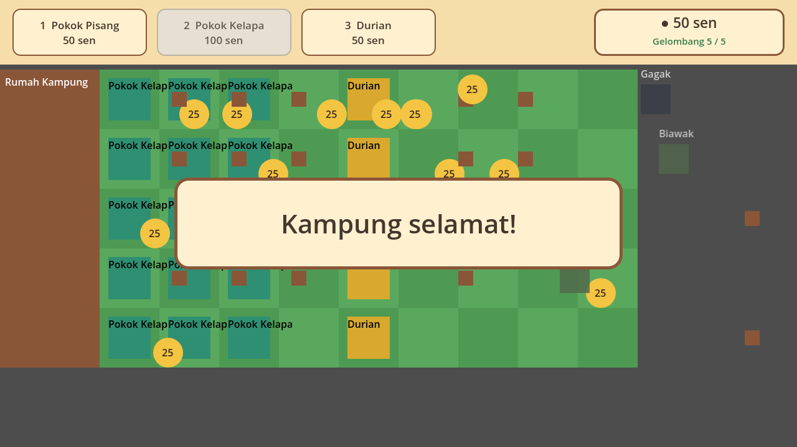

# Kampung Misteri

A small 2D lane-defense game set in a Malaysian kampung, made with Godot 4.7.2.

Cute pests are crossing the field towards the rumah kampung. Plant kampung plants in
their path: banana trees pay for everything, coconut trees lob coconuts, and a durian
makes every bite hurt. Hold out for five waves to keep the kampung safe.



## Download and play

### macOS

1. Go to [Releases](https://github.com/lerlerchan/kampung-misteri-game/releases) and download `KampungMisteri-macOS.zip`.
2. Unzip it. You get `Kampung Misteri.app` (runs on Apple Silicon and Intel, macOS 11+).
3. The app is not notarized by Apple, so macOS blocks the first launch.
   Right-click the app, choose **Open**, then click **Open** again.
   If macOS still says the app is damaged, run this once in Terminal:
   ```
   xattr -dr com.apple.quarantine "Kampung Misteri.app"
   ```

### Windows / Linux (from source)

1. Install [Godot 4.7.2](https://godotengine.org/download) (standard, not .NET).
2. `git clone -b kampung-misteri https://github.com/lerlerchan/kampung-misteri-game.git`
3. In Godot, click **Import**, pick `project.godot`, then press **F5**.

If Godot does not start on your graphics card, set
Project Settings > Rendering > Renderer to **Compatibility**.

## How to play

- Collect **sen** coins: click the gold coins that fall from the sky and drop from Pokok Pisang.
- Pick a plant card at the top (click it, or press **1**, **2**, **3**).
- Click an empty grass cell to plant it.
- **Win:** survive all 5 waves — "Kampung selamat!"
- **Lose:** any pest reaches the house — "Rumah diserang!"

### Plants

| Plant | Cost | What it does |
|---|---|---|
| Pokok Pisang | 50 sen | Drops a 25 sen coin every 20 s |
| Pokok Kelapa | 100 sen | Throws coconuts down its lane |
| Durian | 50 sen | Tough wall; every bite hurts the biter |

### Pests

| Pest | What it does |
|---|---|
| Lipas (cockroach) | Fast and weak, comes in swarms |
| Gagak (black crow) | Flies over the first plant it meets |
| Biawak (monitor lizard) | Slow tank with a big bite |

Defeated pests are not killed — they get chased away and run off the field.

## For developers

| Path | What |
|---|---|
| `src/` | Game scripts: `main.gd` (board, coins, waves), `plant.gd`, `pest.gd`, `coconut.gd`, `hud.gd`, `rules.gd` (pure rules) |
| `assets/data/balance.json` | Every tuning number: costs, HP, speeds, waves, timings |
| `design/game-brief.md` | Game design brief |
| `design/ux/hud.md` | HUD layout and colour palette |
| `tests/` | Unit test (`rules`) and autoplay win test |

Run the tests:

```
godot --headless --path . -s res://tests/unit/rules/test_rules.gd
godot --headless --path . -s res://tests/integration/autoplay/autoplay_win.gd
```

Build the macOS release (needs Godot 4.7.2 export templates):

```
godot --headless --path . --export-release "macOS" build/macos/KampungMisteri.zip
```

## Credits

Built with the [Claude Code Game Studios](https://github.com/Donchitos/Claude-Code-Game-Studios)
framework (MIT, see `LICENSE`). Game code by Claude Code, HUD design by Codex.
